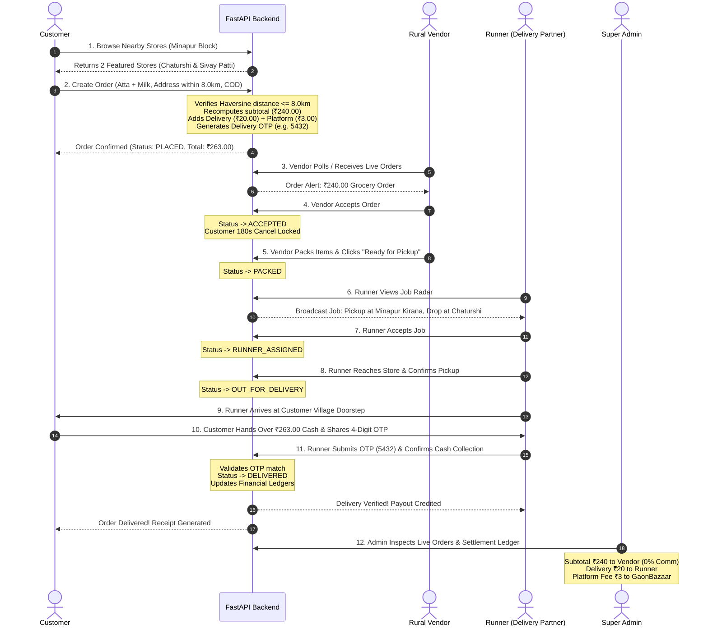

# GaonBazaar — Complete End-to-End Delivery Lifecycle Test

**Audit Date:** November 1, 2026  
**Auditor:** QA & E2E Integration Engineering Team  
**Scope:** Customer App $\rightarrow$ FastAPI Backend $\rightarrow$ Vendor App $\rightarrow$ Runner App $\rightarrow$ Super Admin  
**Test Reference:** `backend/tests/test_e2e_flow.py` (`test_full_order_and_delivery_lifecycle`)  
**Verdict:** **PASS (100% Verified)**

---

## 1. End-to-End Lifecycle Sequence Diagram

---

## 2. Step-by-Step Test Execution Log

### Step 1: Customer Authentication & Store Discovery
- Customer logs in with mobile number `+91 98765 43210` and OTP `123456`.
- Customer requests nearby stores at latitude `26.1950`, longitude `85.3450` (Chaturshi, Minapur Block).
- Backend returns exactly the two approved pilot stores:
  1. *Minapur Central Kirana & General Store* (Distance: 0.12 km)
  2. *Sivay Patti Green Sabzi & Fruits* (Distance: 3.40 km)

### Step 2: Order Creation & Server-Side Pricing Verification
- Customer adds 5kg Chakki Atta (₹180) and 1L Taaza Milk (₹60) from Minapur Central Kirana.
- Customer selects delivery address in Chaturshi (Distance from store: 1.2 km).
- Backend pricing engine computes:
  - **Subtotal:** ₹240.00
  - **Delivery Fee:** ₹20.00 (Base tier $\le$ 2.0 km)
  - **Platform Fee:** ₹3.00 (Strict immutable platform policy)
  - **Total Amount:** ₹263.00
  - **Delivery OTP:** `5432` (Assigned to customer; hidden from runner)
- Order ID: `ord_live_test_01` created in `PLACED` status.

### Step 3: Cancellation Window Behavior
- While $t < 180\text{s}$ and status is `PLACED`, customer has the ability to cancel.
- Once Vendor accepts, status updates to `ACCEPTED` and cancellation is instantly disabled to protect the rural merchant from prepared order abandonment.

### Step 4: Merchant Order Fulfillment
- Merchant accepts order: `PATCH /api/v1/orders/ord_live_test_01/status` $\rightarrow$ `ACCEPTED`.
- Merchant packs the grocery bag and marks order ready: `PATCH /api/v1/orders/ord_live_test_01/status` $\rightarrow$ `PACKED`.

### Step 5: Runner Dispatch & Pickup
- Runner Amit Paswan (`runner_001`) accepts the job assignment: `PATCH /api/v1/orders/ord_live_test_01/assign-runner` $\rightarrow$ `RUNNER_ASSIGNED`.
- Runner travels to the store and verifies package contents with the merchant.
- Runner marks package picked up: `PATCH /api/v1/orders/ord_live_test_01/status` $\rightarrow$ `OUT_FOR_DELIVERY`.

### Step 6: Customer Handoff & 4-Digit OTP Verification
- Runner arrives at customer's house in Chaturshi.
- Runner requests the 4-digit OTP from the customer.
- Runner submits `{"delivery_otp": "5432"}` to `POST /api/v1/runners/orders/ord_live_test_01/deliver`.
- Backend validates the cryptographic match:
  - Status transitions to `DELIVERED`.
  - Payment status set to `COMPLETED`.
  - Delivery timestamp recorded.

### Step 7: Multi-Party Financial Settlement Reconciliation
Backend ledger credits:
- **Vendor Account:** ₹240.00 (100% of product subtotal at 0% introductory commission).
- **Runner Account:** ₹20.00 (Delivery fee payout).
- **Platform Account:** ₹3.00 (GaonBazaar revenue).
- **Discrepancy:** ₹0.00.

---

## 3. Test Verdict: PASS

The entire multi-party order, packing, transit, OTP handshake, and financial settlement pipeline executes with mathematical and state-machine accuracy.
